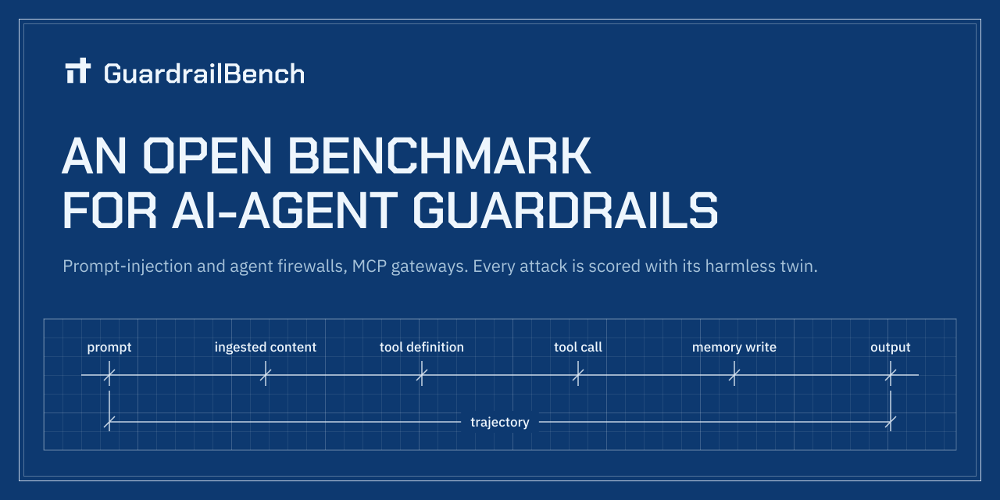

<p align="center"></p>

<p align="center">
  <strong>[ <a href="https://jagga-tech.github.io/guardrailbench/">Website</a> ]</strong>
  <strong>[ <a href="https://jagga-tech.github.io/guardrailbench/">Leaderboard</a> ]</strong>
  <strong>[ <a href="docs/design/measurement-design.md">Method</a> ]</strong>
  <strong>[ <a href="docs/index.md">Docs</a> ]</strong>
</p>

<p align="center">
  <a href="https://github.com/Jagga-tech/guardrailbench/actions/workflows/ci.yml"></a>
  <a href="LICENSE"></a>
  <a href="LICENSE-DATA"></a>
  <a href="pyproject.toml"></a>
</p>

# GuardrailBench

Code and data for GuardrailBench, an open, vendor-neutral benchmark of AI-agent guardrail products: prompt-injection and agent firewalls, and MCP gateways.

Guardrail products say they stop attacks on AI agents. Most reports test one product on the vendor's own data, count missed attacks but not normal work that gets blocked, and change with how the test harness wires the product in. GuardrailBench uses one harness, public adapters, and a scoring rule that counts both kinds of error.

## News

- **Nov 2026**: The repository is open.
- **Nov 2026**: The v1 case set is in: 880 attack cases, each with a benign twin, plus 2,000 normal cases.
- **Nov 2026**: Scoring uses a pair score and a deployment-card track.
- **Nov 2026**: A reliability track covers consistency, stability, load, long inputs and failure behaviour.

## Overview

A **case** is one thing an agent is about to see or do: a user prompt, a document it read, a tool definition, a tool call, a memory write, an answer, or a multi-step run. The product's job is to say allow or block. Each case records where the guard sits (its **checkpoint**), the attack family, a label, and a marker that shows where the harmful part is.

Every attack has a **benign twin** that differs in exactly one thing: the same calendar invite with a real meeting note instead of a hidden instruction, or the same refund call from a user who is allowed to make it. Each attack is scored together with its twin, so a product that blocks everything does not win. The product must stop the attack and let the twin through.

The seven checkpoints:

```
  user ──▶ [prompt] ──▶ ┌─────────┐ ──▶ [tool_definition] ──▶ tools / MCP servers
                        │  agent  │ ──▶ [tool_call] ──────────▶ actions
 documents, web, mail ─▶│         │ ◀── [ingested_content] ◀─── tool results
                        │         │ ──▶ [memory_write] ───────▶ memory
                        └─────────┘ ──▶ [output] ─────────────▶ user
                      multi-step runs: [trajectory]
```

Load the public practice split in three lines:

```python
from pathlib import Path
from guardrailbench.case import load_cases

cases = load_cases(Path("cases/practice/v1.jsonl"))  # 571 cases, each with fields like id, checkpoint, label, messages
print(len(cases), cases[0].id, cases[0].checkpoint, cases[0].label)
```

More on the fields in [the case format](docs/reference/case-format.md). Counts by family, checkpoint and sector are in [Cases in v1](docs/reference/cases-v1.md).

## Set Up

You need Python 3.11+ and [uv](https://docs.astral.sh/uv/).

```
git clone https://github.com/Jagga-tech/guardrailbench
cd guardrailbench
uv sync --extra dev
uv run guardrailbench validate cases/practice
```

Without uv: `pip install -e .`. Some products need an extra package, see [installation](docs/installation.md).

## Usage

Commands are shown without `uv run`. Add it in front if you use uv.

```
guardrailbench validate cases/practice
guardrailbench run --product fake --cases cases/practice --out runs/fake/practice.jsonl
guardrailbench score --results runs/fake/practice.jsonl --cases cases/practice --out results/fake/practice/report.json
guardrailbench reliability --product fake --cases cases/practice --out runs/fake/reliability
guardrailbench leaderboard --results results --out site
```

- `validate` checks the case files.
- `run` sends every case to a product and records its decisions. The `fake` product allows everything, so it checks the plumbing, not detection. `--track card` also gives each case's deployment card to products that accept one.
- `score` turns the decisions into a report: pair score (strict and lenient), detection and false-block rates, and the unsure rate.
- `reliability` repeats and perturbs cases to measure consistency, stability, load, long inputs and failures.
- `leaderboard` builds a static page from every `results/<product>/<split>/report.json`.

All commands and flags: [command line reference](docs/reference/cli.md). Step by step: [run a product](docs/guides/run-a-product.md). To connect a product that is not built in: [write an adapter](docs/guides/write-an-adapter.md). How scores are computed: [metrics](docs/reference/metrics.md). Reliability keys: [reliability guide](docs/guides/reliability.md).

## Downloads

| Item | Where |
|---|---|
| Practice split | [`cases/practice/v1.jsonl`](cases/practice/v1.jsonl) (571 cases) and a 20-case [seed file](cases/practice/seed.jsonl) |
| Official split | Hidden. The SHA-256 fingerprint of the frozen split is in [`cases/OFFICIAL_SHA256`](cases/OFFICIAL_SHA256). Check any split with `guardrailbench hash <path>`. |
| Case-writing guide | [`docs/case-writing-guide.md`](docs/case-writing-guide.md) |
| Review log | [`docs/case-review-log.md`](docs/case-review-log.md) |

3,189 of the 3,760 v1 cases are in the official split, which stays local. Cases are licensed CC BY 4.0. Please do not train on them: they carry `GRB-CANARY-` strings.

## Submitting results

Run the public practice split with your own keys and open a pull request with per-case logs. Practice results go on a clearly labelled unverified tier. Official-split runs are done only by maintainers, and a result becomes verified after maintainers re-run a random sample. See [submit results](docs/guides/submit.md) and [CONTRIBUTING.md](CONTRIBUTING.md).

## Status

Pre-release (1.0.0-rc1). There are no published leaderboard results yet. Human review of the cases is pending, so no case is marked "Verified" yet.

## Contributions

Adapters, case reports and results are welcome. Read [CONTRIBUTING.md](CONTRIBUTING.md) first. How decisions are made and how conflicts of interest are handled: [GOVERNANCE.md](GOVERNANCE.md). Report harness vulnerabilities privately, as described in [SECURITY.md](SECURITY.md). Everyone taking part agrees to the [Code of Conduct](CODE_OF_CONDUCT.md).

Contact: open a [GitHub issue](https://github.com/Jagga-tech/guardrailbench/issues), or use [private vulnerability reporting](https://github.com/Jagga-tech/guardrailbench/security/policy) for anything sensitive. Questions are welcome too, see the [FAQ](docs/faq.md) first.

## Citation and license

See [CITATION.cff](CITATION.cff). GitHub shows a "Cite this repository" button.

Code is Apache-2.0 ([LICENSE](LICENSE)). Cases and docs are CC BY 4.0 ([LICENSE-DATA](LICENSE-DATA)). Changes are listed in [CHANGELOG.md](CHANGELOG.md).
